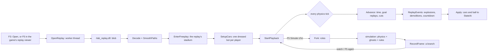

# RLReplayLab: architecture (the technical level)

For the concepts (replay, freeplay, fork, ghost, branch, phase...) read [OVERVIEW.md](OVERVIEW.md) first.

## Repository map

| Path | What |
| --- | --- |
| `bakkesmod/ReplayLab/` | **the plugin** (C++17, MSVC ABI, BakkesMod SDK), compiled to `ReplayLab.dll` |
| `bakkesmod/rlab_replay/` | the replay reader (Rust, subtr-actor 1.5.1 + boxcars 0.13), compiled to `rlab_replay.dll`, C ABI |
| `bakkesmod/rlab_replay/examples/` | exploration tools run natively on Linux (`flow`, `goals`, `moves`, `cams`, `saves`, `dump`...) |
| `bakkesmod/nexto/` | Nexto's network in C++ (`nexto.cpp`), its weights (`nexto.bin`), export and test tools |
| `bakkesmod/sdk/`, `imgui_src/`, `toolchain/` | BakkesMod SDK (submodule), its ImGui, MSVC headers/libs fetched by xwin |
| `bakkesmod/build.sh`, `install_plugin.sh`, `lancer_bakkesmod.sh` | build (Linux cross-compile), install into the Proton prefix, inject BakkesMod |
| `bakkesmod/video/` | scripts that film a presentation of the plugin over RCON |
| `lab/`, `static/`, `vendor/nexto/`, `cache/` | the web lab (Python server + RocketSim + three.js); independent of the plugin |

## The replay reader (Rust) and the blob

`rlab_replay.dll` exports three C functions, loaded by the plugin with `LoadLibrary` from `plugins/replaylab/`:

| Function | Returns |
| --- | --- |
| `rlab_parse_replay(path, &ptr, &len, err, errLen)` | the whole replay as an "RLAB" blob |
| `rlab_replay_header(path, ...)` | the header as text, one `key=value` per line (map, date, team size, score, `ReplayName`, players) |
| `rlab_free(ptr, len)` | frees a buffer returned by either |

Panics are caught (`catch_unwind`) and turned into an error message: nothing unwinds across the C ABI.

The blob (little endian; `str` = u16 length + UTF-8). Each version appends to the previous one; the plugin's `Decode`
(`ReplayFile.cpp`) reads versions 1 to 5.

| Part | Content |
| --- | --- |
| header (v1) | `"RLAB"`, u32 version, str map, str date, u32 frames, u32 players; per player: str name, u8 team |
| per frame (v1) | f32 time, i32 seconds remaining; ball body; per player: body, u8 boost (0-255), u8 boosting |
| body | u8 valid, f32×3 position, f32×4 rotation quaternion (x, y, z, w), f32×3 velocity, f32×3 angular velocity (rad/s) |
| per player frame (v4) | + u8 moves: 1 jumping, 2 double jumping, 4 dodging (v5: 8 powersliding) |
| per player frame (v5) | + u8 throttle, u8 steer (0-255, 128 = neutral) |
| events (v1) | u32 goals: (u32 frame, u8 scoring team); u32 saves: (u32 frame, u8 player) |
| looks (v2) | per player: u8 known; if known: u8 slots × (u8 slot, u32 product, i32 paint or -1), u8 team colour, u8 accent colour, u32 team finish, u32 accent finish |
| cameras (v3) | str ball archetype (the game mode); per player: u8 known; if known: f32×7 settings, u32 changes × (f32 time, u8 ball cam on) |
| match (v5) | per frame: u8 phase (0 other, 1 countdown, 2 playing, 3 goal), u8 countdown number; i32×2 score when the replay starts; per goal: u8 scorer, u8 assist (255 none); u32 demolitions × (u32 frame, u8 victim, u8 attacker) |
| boost pads (v6) | u32 events × (f32 x, f32 y of the pad, f32 time, u8 1 taken / 0 back) |

What the reader works out (all checked on 86 real replays with `examples/flow.rs`):

- **Phase**: from `TAGame.GameEvent_TA:ReplicatedStateName`, an index into the replay's *name table* (so the number
  differs between replays): `Countdown`, `Active`, `PostGoalScored` or `ReplayPlayback`. The countdown number comes from
  `ReplicatedRoundCountDownNumber` (subtr-actor's `replicated_game_state_time_remaining` is not it).
- **Demolitions**: a demolished car stays in the data hidden and asleep (~85 frames) where it blew up, then is
  recreated. The reader writes those frames as invalid and lists the demolitions (subtr-actor's `demolish_infos`).
- **Score at the start**: a match joined late does not start at 0-0. The replay records a team's score when that team
  scores, so it comes from each team's first goal, else from the header's final score.
- **Assist**: the assist stat event is counted 0-12 frames after its goal.

## The plugin

### Source files

| File | Responsibility |
| --- | --- |
| `ReplayLab.h` | every type (`ReplayData`, `RBody`, `State`, `Look`, `GoalReplay`, `Settings`...) and the plugin class, its members grouped by the file that implements them |
| `ReplayLab.cpp` | entry: `onLoad` (console variables and commands, game hooks), `onUnload`, `BindSettings`, loading `rlab_replay.dll` |
| `Input.cpp` | F keys (read from Windows directly: Proton can lose the keyboard after Alt+Tab), controller d-pad short/long presses, A |
| `ReplayFile.cpp` | the replay list (thread), reading a replay (thread), `Decode`, path smoothing, the goal-to-kickoff `cuts` |
| `Scene.cpp` | freeplay in the replay's stadium and mode; bots: spawning, dressing (`SetBotLoadout` before the car is built), mapping cars to players, paint, parking |
| `Playback.cpp` | the per-tick loop: `OnCarInput` -> `Advance` (time) -> `Apply` (place every car and the ball); `StateAt` (interpolation) |
| `Match.cpp` | the replay played like the match: phases, cuts, goal replays, explosions, demolitions, countdown messages, banners, fade |
| `Simulation.cpp` | `Fork`, roles, the simulation's match rules (clock, 0 second, overtime), demolitions, Nexto |
| `Branches.cpp` | recording each simulation (a try), saving it as a branch on demand, watching, retrying |
| `Camera.cpp` | cameras like the replay viewer: the game's camera made to follow another car, each player's camera settings and ball cam |
| `Hud.cpp` | canvas drawing: scoreboard, name tags, captions, help lines, simulation wireframes |
| `Window.cpp` | the F3 ImGui window and the F2 settings tab |
| `Rules.h` | constants and game rules shared by several files (modes, arenas, goal tests, roles) |
| `LabMath.h`, `Draw.h`, `Palettes.h` | vector/rotation math; canvas helpers and team colours; car paint palettes |

### Data flow

- **Threads.** Game hooks (car input per car per tick, the viewport tick, the canvas) run on the game thread. The F3
  window renders on BakkesMod's render thread and queues its actions with `gameWrapper->Execute`. Replay reading and
  the replay list run on worker threads (`RunWorker`: joined before the next one and on unload). A `recursive_mutex`
  (`mtx`) guards the shared state.
- **The tick.** The local car's `SetVehicleInput` comes once per physics tick (120 per second of game time, none while
  paused): that is when time advances and everything that follows the replay is placed. If no tick comes through
  (your car demolished), `OnFrame` (the viewport tick) does it instead.
- **Interpolation.** At load, each path is re-solved so it moves at the recorded velocities while staying within ~10
  units of the recorded positions (a tridiagonal least-squares). Between frames, `StateAt` uses a cubic Hermite curve
  along the velocities; across a goal's cut it holds still; a car missing at a frame but present the next one (kickoff
  reset) takes the next one's state.

### The match flow (Match.cpp)

| Replay moment | What the plugin does |
| --- | --- |
| countdown frames | sends the game's own countdown messages (`SendCountdownMessage` 3, 2, 1, `SendGoMessage`) as their numbers change |
| goal frame (crossed while playing forward) | `ExplodeBall`: `Ball.Explode(goal, spot, scorer bot's PRI)` with the net's team set to the defending team (freeplay gives both nets team 1; the explosion's colour comes from it), restored next frame; scorer banner (name, assist, km/h) |
| goal phase | ball gone (the exploded ball dissolves by itself; a ball seeked into is hidden) |
| the goal's cut (`cuts`, computed in `Decode`) | its replay (`StartGoalReplay`: 6 s before to 2.5 s after, camera on the scorer, REPLAY screen), or a jump to the kickoff; the screen fades through black |
| kickoff | `RenewBall`: a new ball (`ResetBalls`, from the viewport tick, never inside a physics step), as the game does at each kickoff |
| demolition frame | `car.Demolish()` where it is; the game respawns it ~3 s later, as in the replay |

In a simulation: the boost pads start as they were in the replay at the fork (`PadsAtFork`: every pad back with
`ResetPickups`, then the ones taken and not back yet taken again, each back when it came back in the replay; pads are
known by address once the game picked one up or respawned it). While watching, `SyncPads` sets every known pad to the
replay's state at that moment each tick, with the game's respawn timer held off (`PAD_HELD` delay; each pad's own delay
is restored at a fork and on unload), so pads follow seeks and stand still while paused. At a fork each known pad is set by hand (`ResetPickups` leaves
the last try's pads taken in freeplay), and a try records its pads (`RecordPad`, after the source's events up to the
fork) so it plays and forks like a replay; a ghost that a car driving itself comes within `BUMP_DIST` of is let go
(`Bumped`): the collision is the game's, then the Psyonix AI plays it; a fork during a countdown or a goal phase starts at the next kickoff with a 3 s countdown where
everything is held (`kickoff`); a goal explodes with the explosion of the last toucher of the scoring team
(`Car_TA.OnHitBall` hook); 2.5 s later the branch is replayed from 6 s before the goal (`ReplaySimGoal`).

### Bots and memory

- One bot per replay player, named after him (plain characters only). A bot keeps the body it was built with, so bots
  are reused by body across replays; one that wears another look is demolished to be rebuilt with the new look.
- "Toi" drives the player's own bot (`rlab_voiture_joueur`, default): `CarPlayer()` (the player your own car stands
  for) is then -1, so your car is stashed out of the way as when you watch, the bot of that player is kept, your
  controller's input (read on your car's tick) is copied to it in `OnCarInput`, the camera follows it (player view)
  with your camera settings and your own ball cam flag copied onto it, and your stashed car gets its boost each tick so
  the game's own boost meter shows it. Giving your own car his look failed: the game builds your car from your preset
  each time (a loadout set on your player info is lost at the next car), and BakkesMod's item mod does not change the
  body (so the hitbox stays yours). With `rlab_voiture_joueur 0`, `ownCar` (settled in `SetupCars`) makes your own
  car stand for the player instead.
- Bots are never removed: removing one from freeplay crashed the game. When more than `MAX_SPARE_BOTS` (5) extra bots
  have piled up, opening a replay reloads freeplay, which removes them all. (Published freeplay plugins remove bots
  with `controller = car.GetAIController(); car.Destroy(); sw.RemovePlayer(controller)`; untested here.)
- Several `SpawnBot` in the same frame lose bots: they are spawned one at a time, each waited for.
- Tries: only the last one is kept until it is saved (`SaveBranch`); saved branches: at most 8, at most 300 s each,
  recorded at 60 Hz. A replay of 10 minutes with 6 players is about 8 MB.
- Settings (`rlab_*` console variables) are bound once into `Settings opt`; nothing is looked up by name per tick. Per
  tick vectors (`onPitch`, `lastValid`) are kept as members.

## The web lab (briefly)

`lancer_lab.sh` starts `lab/server.py` (Python): it parses replays (`lab/parse_replay.py`, cached in `cache/`), runs
RocketSim for "what if" simulations (`lab/sim.py`, `lab/whatif.py`), can drive cars with Nexto in Python
(`lab/nexto_brain.py`, `vendor/nexto`), and serves a three.js viewer (`static/`). See the root `README.md` (French).
